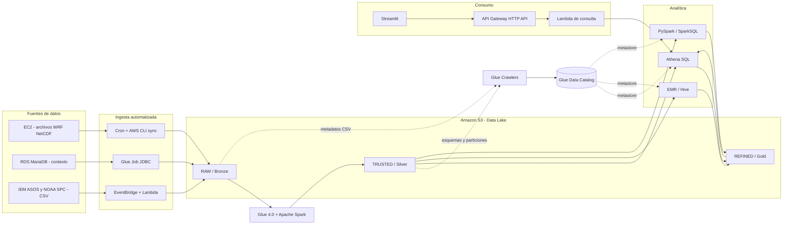
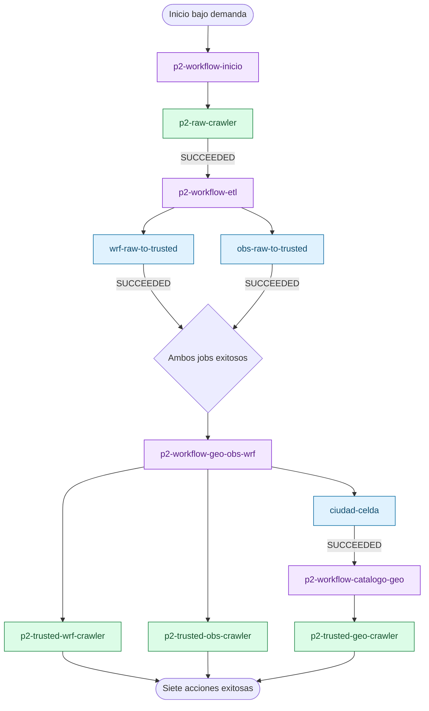

# bigWRF | Big Data para el análisis meteorológico

**Universidad EAFIT · SI3007 Sistemas Distribuidos / ST0263 Tópicos Especiales en Telemática · Proyecto 2 · 2026-2**


bigWRF es un proyecto de procesamiento distribuido de datos meteorológicos sobre AWS. Integra resultados de una simulación científica WRF, datos geográficos almacenados en una base de datos relacional y observaciones meteorológicas públicas, con el objetivo de analizar un mismo evento desde diferentes fuentes de información.

La solución implementa un Data Lake con arquitectura Medallion, mecanismos de ingesta automatizados, procesamiento ETL con Apache Spark, un catálogo centralizado de metadatos y una capa de análisis y visualización. El principal objetivo técnico es convertir datos científicos multidimensionales en conjuntos de información tabulares, reproducibles y accesibles mediante diferentes motores de procesamiento distribuido.

## Contenido

- [Producto final](#producto-final)
- [Objeto de estudio](#objeto-de-estudio)
- [Arquitectura y workflow](#arquitectura-y-workflow)
- [Herramientas utilizadas](#herramientas-utilizadas)
- [Fuentes e ingesta](#fuentes-e-ingesta)
- [Preparación de datos](#preparación-de-datos)
- [Catalogación y orquestación](#catalogación-y-orquestación)
- [Análisis realizado](#análisis-realizado)
- [Resultados y validación](#resultados-y-validación)
- [Reproducción del proyecto](#reproducción-del-proyecto)
- [Estructura del repositorio](#estructura-del-repositorio)

## Producto final

El producto es una plataforma de analítica meteorológica basada en un Data Lake. En lugar de consultar directamente archivos NetCDF de varios gigabytes o combinar manualmente archivos CSV, el usuario puede trabajar con tablas SQL y DataFrames previamente preparados.

La arquitectura separa la adquisición de información, su preparación y la obtención de resultados analíticos. La capa de consumo propuesta para el proyecto utiliza una aplicación Streamlit y una API HTTP basada en Amazon API Gateway, AWS Lambda y Athena, alimentadas por los resultados persistidos en REFINED. De esta forma, la visualización no requiere ejecutar nuevamente todo el procesamiento científico cada vez que se consulta un resultado.

El aporte del proyecto no es generar una nueva predicción meteorológica en AWS, sino construir una infraestructura capaz de integrar, transformar y analizar datos científicos existentes, conservar su trazabilidad y facilitar su consumo.

| Indicador de la ejecución validada | Resultado |
| --- | ---: |
| Registros meteorológicos WRF | 3.356.275 |
| Instantes de simulación | 25 |
| Celdas espaciales por instante | 134.251 |
| Tablas RAW y TRUSTED catalogadas | 12 |
| Conjuntos de datos TRUSTED | 7 |
| Tamaño total de TRUSTED | 57,1 MiB |
| Glue Jobs de preparación | 3 |
| Glue Crawlers | 4 |

## Objeto de estudio

El caso de estudio corresponde al derecho Chicago–Gary del 11 de agosto de 2026, estudiado previamente mediante el modelo **Weather Research and Forecasting (WRF)** durante SCC26. Un derecho es un evento convectivo organizado asociado a vientos intensos que afectan extensiones geográficas considerables.

Se analiza la corrida con el esquema de microfísica **Thompson**, utilizando el dominio exterior `d01`, con resolución espacial nominal de 3 km. El conjunto incluye salidas horarias desde las 00 UTC del 11 de agosto hasta las 00 UTC del 12 de agosto de 2026, para un total de 25 instantes. El intervalo principal de análisis es de 12 a 20 UTC del 11 de agosto.

La información simulada se complementa con observaciones de estaciones ASOS, reportes de viento del Storm Prediction Center (SPC) y datos de contexto de ciudades, estaciones y características computacionales de la corrida. Esto permite estudiar la distribución espacial y temporal del viento, la temperatura y la precipitación, así como evaluar la correspondencia entre el modelo y las observaciones.

El alcance final se limita a Thompson y d01. Los archivos d02 se mantienen en RAW y no se mezclan con la malla analizada. No se realiza una comparación entre esquemas de microfísica.

## Arquitectura y workflow

La arquitectura se despliega en `us-east-1` sobre AWS Academy Learner Lab. Se utiliza **un único bucket S3** con tres zonas lógicas; no son tres buckets independientes.



El diagrama representa el flujo lógico del proyecto completo. Los crawlers registran metadatos; no copian ni transforman los datos. Los motores analíticos consultan directamente los archivos almacenados en S3, utilizando Glue Data Catalog cuando corresponde.

| Zona | Función | Formatos |
| --- | --- | --- |
| `raw/` (Bronze) | Preservar los datos tal como se reciben de las fuentes. | NetCDF, CSV |
| `trusted/` (Silver) | Almacenar datos normalizados, estructurados y relacionados. | Parquet + Snappy |
| `refined/` (Gold) | Persistir resultados de las preguntas de negocio para su consumo posterior. | Preferentemente Parquet |

Las ingestas se ejecutan de forma independiente. El workflow de preparación y catalogación se inicia bajo demanda una vez que los datos RAW están disponibles. La etapa analítica consume TRUSTED y escribe sus resultados en REFINED; no forma parte de los cuatro triggers del workflow de preparación.

## Herramientas utilizadas

| Herramienta | Responsabilidad dentro del proyecto |
| --- | --- |
| Amazon EC2 | Fuente de archivos WRF y entorno de cómputo para la solución. |
| Amazon RDS (MariaDB) | Fuente relacional de ciudades, estaciones y metadatos de corrida. |
| Amazon S3 | Almacenamiento del Data Lake, scripts, resultados y logs de EMR. |
| AWS Lambda | Descarga de CSV públicos; capa de ejecución de la API según el diseño de consumo. |
| Amazon EventBridge | Programación de la ingesta desde las fuentes URL. |
| AWS Glue Jobs | Exportación JDBC y procesamiento ETL distribuido. |
| Apache Spark / PySpark | Transformaciones, ventanas temporales, cruces geográficos y análisis descriptivo. |
| netCDF4 y NumPy | Lectura de variables multidimensionales de WRF y conversión a registros tabulares. |
| Apache Parquet + Snappy | Almacenamiento columnar y compresión de los datos preparados. |
| Glue Crawlers y Data Catalog | Descubrimiento de tablas, esquemas, formatos y particiones. |
| AWS Glue Workflows / Triggers | Orquestación de jobs y crawlers de acuerdo con sus dependencias. |
| Amazon Athena | Consultas SQL serverless sobre S3 y validación de resultados. |
| Amazon EMR 6.15.0 | Infraestructura de Hadoop, Hive y Spark para analítica distribuida. |
| Apache Hive y SparkSQL | Procesamiento analítico mediante SQL. |
| API Gateway y Streamlit | Interfaz HTTP y presentación de resultados, según la arquitectura del proyecto. |
| Terraform | Aprovisionamiento declarativo de infraestructura y configuración de servicios. |
| CloudWatch | Logs, métricas y diagnóstico de las ejecuciones. |
| AWS Secrets Manager / IAM | Manejo de secretos y permisos mediante los roles disponibles en Learner Lab. |
| AWS CLI / boto3 | Operación de los servicios, consultas y automatización programática. |

## Fuentes e ingesta

Se integran tres tipos de fuentes, cada una con un mecanismo de ingesta acorde con su naturaleza.

| Fuente | Mecanismo | Destino RAW |
| --- | --- | --- |
| Archivos WRF en EC2 | Tarea programada que sincroniza los archivos mediante `aws s3 sync`. | `raw/wrf/esquema=thompson/` |
| RDS MariaDB | Glue Job `p2-rds-to-raw`, conexión JDBC `p2-rds-mariadb` y trigger programado. Exporta CSV con encabezado. | `raw/rds/cities/`, `raw/rds/stations/`, `raw/rds/runs/` |
| Observaciones ASOS | Lambda `p2-ingest-url` programada mediante EventBridge. | `raw/url/asos/fecha=2026-08-11/asos.csv` |
| Reportes de viento SPC | La misma Lambda obtiene el CSV de reportes públicos. | `raw/url/spc/fecha=2026-08-11/wind_reports.csv` |

Los datos descargados desde las fuentes públicas se conservan en RAW sin realizar transformaciones. El job JDBC se encarga de materializar las tablas relacionales en archivos CSV de manera que las siguientes etapas no dependan de consultar directamente RDS.

La base relacional se inicializa mediante [`schema.sql`](data_origin/rds/schema.sql) y [`seed.sql`](data_origin/rds/seed.sql). Los scripts de ingesta se encuentran en [`intake/glue_rds/rds_to_raw.py`](intake/glue_rds/rds_to_raw.py) e [`intake/lambda_url/handler.py`](intake/lambda_url/handler.py).

## Preparación de datos

Los tres jobs ETL se ejecutan en AWS Glue 4.0 con Spark 3.3, dos workers `G.1X` por job, Python y métricas de ejecución habilitadas. Se definen en [`infra/glue_etl.tf`](infra/glue_etl.tf).

### Job 1 — `wrf-raw-to-trusted`

Script: [`wrf_raw_to_trusted.py`](preparacion_datos/wrf_raw_to_trusted.py).

Spark no lee NetCDF de manera nativa. Para resolverlo, el driver enumera los objetos de S3 que corresponden a `wrfout_d01_*` y distribuye sus claves mediante `parallelize` y `mapPartitions`. Cada tarea descarga su archivo a un directorio temporal, utiliza `netCDF4` (versión 1.7.2) para leer sus variables y emite un registro por celda e instante. Posteriormente, Spark aplica las transformaciones sobre un DataFrame distribuido.

| Campo resultante | Transformación | Unidad |
| --- | --- | --- |
| `t2_c` | `T2 - 273.15` | °C |
| `viento_10m` | `sqrt(U10² + V10²)` | m/s |
| `lluvia_acum_mm` | `RAINC + RAINNC` | mm |
| `lluvia_hora_mm` | Acumulado actual menos acumulado anterior | mm |
| `hora` | Conversión de `Times` a timestamp | UTC |
| `lat`, `lon` | Coordenadas de `XLAT` y `XLONG` | grados |

La precipitación horaria se calcula mediante una ventana `lag` agrupada por `(esquema, i, j)` y ordenada por `hora`. Solo se obtiene una diferencia cuando los instantes están separados por exactamente 3.600 segundos. El primer instante no tiene precipitación horaria calculable y se conserva como nulo. Se corrigen únicamente negativos diminutos asociados a la precisión numérica, conservando diferencias negativas significativas para su revisión.

El resultado se escribe en `trusted/wrf_superficie/`, particionado por `esquema` y `fecha`. La granularidad de la tabla es una fila por esquema, celda e instante temporal.

### Job 2 — `obs-raw-to-trusted`

Script: [`obs_raw_to_trusted.py`](preparacion_datos/obs_raw_to_trusted.py).

Convierte los CSV a Parquet, normaliza los identificadores y tipos de datos, valida coordenadas y representa valores faltantes (`M`, `UNK`) como nulos. Las observaciones ASOS se convierten de Fahrenheit a Celsius, de nudos a m/s y de pulgadas a mm; las trazas de precipitación se conservan con un indicador específico. Los reportes SPC se convierten de mph a m/s y se ajustan temporalmente teniendo en cuenta el cambio de día de la ventana de reportes.

Para permitir comparaciones con WRF, se conserva la hora original de la observación ASOS y se genera una referencia al instante horario más cercano, junto con el desfase temporal. La selección de observaciones apropiadas se realiza durante el análisis, evitando confundir observaciones múltiples con horas independientes.

Produce `ciudades`, `estaciones`, `corridas`, `obs_asos` y `reportes_spc`.

### Job 3 — `ciudad-celda`

Script: [`ciudad_celda.py`](preparacion_datos/ciudad_celda.py).

La malla WRF y las coordenadas reales de las ciudades y estaciones utilizan representaciones espaciales diferentes. El job extrae la malla del primer instante de cada esquema y realiza un cruce con las ubicaciones de interés. Mediante `broadcast`, Spark distribuye las 38 ubicaciones entre los ejecutores; Haversine calcula la distancia geográfica y una ventana ordenada por distancia selecciona la celda más cercana.

Se realizan 5.101.538 comparaciones (134.251 celdas × 38 ubicaciones) y se obtienen 38 correspondencias. La distancia promedio es 1,165 km y la máxima 2,057 km, valores coherentes con la resolución nominal de la malla. Esto permite realizar JOIN posteriores por `(esquema, i, j)` sin repetir el cálculo geográfico.

### Contrato de datos de TRUSTED

Todas las tablas se almacenan en `s3://<bucket>/trusted/<tabla>/` como Parquet comprimido con Snappy.

| Tabla | Filas | Campos relevantes |
| --- | ---: | --- |
| `wrf_superficie` | 3.356.275 | `esquema`, `fecha`, `hora`, `i`, `j`, `lat`, `lon`, `t2_c`, `viento_10m`, `lluvia_acum_mm`, `lluvia_hora_mm` |
| `ciudades` | 20 | `city_id`, `name`, `state`, `lat`, `lon`, `population` |
| `estaciones` | 18 | `station_id`, `name`, `state`, `lat`, `lon` |
| `corridas` | 1 | `run_id`, `esquema`, `mp_physics`, `ranks`, `walltime_s`, metadatos computacionales |
| `obs_asos` | 1.386 | `station_id`, `hora_obs`, `hora`, `desfase_min`, `t2_c`, `viento_10m`, `rafaga_ms`, `lluvia_hora_mm` |
| `reportes_spc` | 1.031 | `hora`, `viento_mph`, `viento_ms`, `location`, `county`, `state`, `lat`, `lon`, `comments` |
| `ciudad_celda` | 38 | `esquema`, `tipo`, `city_id`, `station_id`, `nombre`, `i`, `j`, `distancia_km` |

Las fechas y horas se interpretan en UTC. `esquema` y `fecha` son particiones de tipo string en Glue Data Catalog; `hora` es timestamp. En los cruces con ASOS debe utilizarse viento sostenido, no ráfagas, y una regla explícita de alineación temporal para evitar duplicar las observaciones.

## Catalogación y orquestación

Glue Data Catalog funciona como metastore centralizado. Las bases `derecho_raw`, `derecho_trusted` y `derecho_refined` corresponden a las tres zonas del Data Lake. Los cuatro crawlers se definen en [`infra/glue_crawlers.tf`](infra/glue_crawlers.tf).

| Crawler | Base de datos | Tablas |
| --- | --- | --- |
| `p2-raw-crawler` | `derecho_raw` | `cities`, `stations`, `runs`, `asos`, `spc` |
| `p2-trusted-wrf-crawler` | `derecho_trusted` | `wrf_superficie` |
| `p2-trusted-obs-crawler` | `derecho_trusted` | `ciudades`, `estaciones`, `corridas`, `obs_asos`, `reportes_spc` |
| `p2-trusted-geo-crawler` | `derecho_trusted` | `ciudad_celda` |

NetCDF no se cataloga directamente en RAW; su representación tabular queda registrada en TRUSTED. EMR se configura para utilizar Glue Data Catalog como metastore de Hive y Spark, mediante `hive-site` y `spark-hive-site` en [`infra/emr.tf`](infra/emr.tf). Athena accede al mismo catálogo a través de `AwsDataCatalog`.

### Workflow de preparación y catalogación

El workflow `p2-preparacion-catalogo`, definido en [`infra/glue_workflow.tf`](infra/glue_workflow.tf), encadena **tres jobs y cuatro crawlers mediante cuatro triggers**. Su propósito es garantizar el orden de ejecución, aprovechar el paralelismo entre procesos independientes y evitar que se cataloguen datos antes de que finalice su preparación.



| Trigger | Tipo | Condición de inicio | Acción |
| --- | --- | --- | --- |
| `p2-workflow-inicio` | ON_DEMAND | Inicio explícito del workflow | Crawler RAW |
| `p2-workflow-etl` | CONDITIONAL | RAW exitoso | Jobs WRF y OBS en paralelo |
| `p2-workflow-geo-obs-wrf` | CONDITIONAL | WRF **y** OBS exitosos | Job GEO y crawlers WRF y OBS |
| `p2-workflow-catalogo-geo` | CONDITIONAL | GEO exitoso | Crawler GEO |

Los tres últimos crawlers constituyen las acciones terminales del flujo; el estado satisfactorio se verifica a partir de las estadísticas de ejecución, no solamente del estado global del workflow. Se establece `max_concurrent_runs = 1`, además del límite de una ejecución simultánea por job. Las dependencias se activan dentro del workflow y no por ejecuciones manuales independientes de los jobs.

Se utiliza un disparador bajo demanda porque los datos corresponden a un evento histórico. No se justifica reprocesar continuamente el mismo conjunto de información. Los jobs sobrescriben sus salidas, por lo que el workflow debe ejecutarse en una ventana coordinada, sin consumidores leyendo simultáneamente TRUSTED. Los logs y métricas se consultan en CloudWatch.

## Análisis realizado

Las preguntas de negocio se distribuyen entre diferentes motores de procesamiento para demostrar que los datos preparados pueden ser consumidos por SQL, Hive, SparkSQL y PySpark. El siguiente cuadro recoge el alcance analítico del documento maestro actualizado, adaptado a la única corrida disponible.

| Pregunta | Análisis | Herramienta | Fuentes principales |
| --- | --- | --- | --- |
| P1 | Viento máximo a 10 m, instante y ubicación. | Athena | WRF, ciudades |
| P2 | Ranking de ciudades según el viento máximo simulado. | Hive en EMR | WRF, ciudad-celda |
| P3 | Área del dominio con viento severo por hora. | PySpark | WRF |
| P4 | Precipitación acumulada máxima del dominio y distribución por ciudades. | SparkSQL | WRF, ciudad-celda |
| P5 | Descensos horarios de temperatura asociados a la piscina fría. | PySpark | WRF, ciudad-celda |
| P6 | Error de viento y precipitación horaria frente a las estaciones ASOS, mediante RMSE y análisis del desfase del pico. | PySpark + Athena | WRF, ASOS, ciudad-celda |
| P7 | Correspondencia de reportes de viento SPC con viento severo simulado, con tolerancia temporal de ±1 hora. | Athena | WRF, SPC |

En P3 y P7 se contempla el umbral de referencia de 25,7 m/s (50 kt, aproximadamente). La versión implementada de la preparación conserva `corridas` como tabla de contexto y no incorpora una tabla independiente `umbrales`. No se afirma que el umbral proceda de RDS. Para P3, el área puede estimarse multiplicando el número de celdas afectadas por 9 km², de acuerdo con la resolución nominal; esta es una aproximación de área de malla.

La comparación espacial de reportes SPC requiere asociar cada reporte a una celda, verificar que se encuentra dentro del dominio y aplicar la tolerancia temporal. `ciudad_celda` contiene solo ciudades y estaciones, no reportes SPC.

### Persistencia de los resultados

Los resultados analíticos (máximos, promedios, rankings, series temporales, errores y demás indicadores) se destinan a `refined/`. Se recomienda un prefijo por pregunta y registrar las tablas resultantes en `derecho_refined`. Athena puede materializar resultados mediante CTAS y Spark mediante escritura de DataFrames en Parquet. La ubicación `athena-results/` corresponde a los resultados operativos del workgroup y no sustituye a REFINED.

La capa de visualización puede consumir estos resultados ya calculados mediante la API, reduciendo el trabajo necesario para responder cada solicitud.

## Resultados y validación

Las siguientes cifras corresponden a las ejecuciones registradas durante la implementación de los puntos 4 y 5; no son estimaciones de rendimiento ni tiempos del workflow completo.

| Proceso | Tiempo de ejecución | Resultado |
| --- | ---: | --- |
| WRF (prueba inicial) | 90 s | 268.203 filas, consistentes con el ensayo local |
| WRF (producción) | 160 s | 3.356.275 filas, 25 instantes completos |
| Observaciones y RDS | 65 s | Cinco conjuntos de datos, 2.456 filas |
| Ciudad-celda | 103 s | 38 correspondencias geográficas |

Los dos archivos NetCDF d01 de entrada ocupaban aproximadamente 4,06 GiB. Los 14 archivos Parquet de WRF ocuparon 57 MiB, lo cual representa una reducción aproximada del **98,6 %**. Este resultado combina proyección de variables, almacenamiento columnar y compresión; no corresponde a una compresión sin pérdida de todas las variables originales de NetCDF.

### Validación científica

| Indicador | Referencia SCC26 | Resultado del pipeline |
| --- | ---: | ---: |
| Viento máximo a 10 m | 34,12 m/s | 34,1190437 m/s |
| Precipitación máxima acumulada entre 12 y 20 UTC | 113,8 mm | 113,7814114 mm |

Ambos valores coinciden al redondear con la precisión de referencia. La precipitación máxima acumulada de toda la simulación es de 216,9698334 mm; no debe confundirse con el acumulado durante el intervalo principal. Para este último se calcula primero la diferencia entre las 20 UTC y las 12 UTC en cada celda y luego se obtiene el máximo espacial.

Adicionalmente, una consulta de validación en Athena reprodujo los conteos y máximos obtenidos en Glue: 3.356.275 registros, 25 instantes, 33.611.687 bytes escaneados y 1.364 ms de tiempo total. Los JOIN de validación confirmaron 25 registros de WRF por cada una de las 20 ciudades para el periodo completo. La prueba del workflow fue reportada como exitosa por el equipo.

## Reproducción del proyecto

### 1. Requisitos y configuración

- Cuenta AWS Academy Learner Lab activa con credenciales temporales vigentes y acceso a los servicios necesarios.
- AWS CLI v2, Terraform, Git y acceso a los archivos WRF originales.
- Roles y perfiles existentes en la cuenta. Glue utiliza `LabRole`; EMR utiliza los roles/perfiles parametrizados en `infra/variables.tf`.
- Acceso SSH mediante el par de llaves del laboratorio (por defecto `vockey`) y configuración de la IP autorizada.

```bash
git clone https://github.com/lacastrilf/bigWRF.git
cd bigWRF/infra
aws sts get-caller-identity
terraform init
terraform validate
```

Revisar las variables en [`infra/variables.tf`](infra/variables.tf) y los parámetros específicos de la cuenta antes de desplegar. Como ejemplo, para un despliegue nuevo sin levantar EMR inicialmente:

```bash
terraform plan -var='my_ip_cidr=TU_IP_PUBLICA/32' \
  -var='enable_emr=false' -out=deploy.tfplan
terraform apply deploy.tfplan
```

Sustituir el valor de ejemplo por la IP pública real. Si ya existe infraestructura compartida, utilizar el estado vigente del equipo y revisar cuidadosamente el plan; no ejecutar un despliegue nuevo sobre recursos existentes. EMR se habilita cuando sea necesario, manteniendo las mismas variables de la infraestructura.

### 2. Cargar las fuentes y comprobar la ingesta

Inicializar MariaDB con `data_origin/rds/schema.sql` y `data_origin/rds/seed.sql` y cargar los archivos originales de Thompson en la EC2 fuente. Mantener la carpeta `esquema=thompson/` al sincronizar con `raw/wrf/`, ya que el job WRF extrae el esquema desde la ruta de S3.

Para los comandos siguientes, configurar el bucket según la cuenta (ejemplos para Bash):

```bash
export AWS_DEFAULT_REGION=us-east-1
ACCOUNT_ID=$(aws sts get-caller-identity --query Account --output text)
BUCKET="p2-derecho-${ACCOUNT_ID}"

aws s3 ls "s3://${BUCKET}/raw/" --recursive --human-readable
```

Si es necesario realizar una ingesta manual de prueba, ejecutar los componentes ya desplegados:

```bash
aws glue start-job-run --job-name p2-rds-to-raw
aws lambda invoke --function-name p2-ingest-url \
  --cli-binary-format raw-in-base64-out \
  --payload '{"event_date":"2026-08-11"}' /tmp/bigwrf-ingesta.json
```

Esperar a que finalicen la ingesta JDBC, la descarga de CSV y la sincronización de WRF. Comprobar que se encuentran todos los archivos RAW esperados antes de iniciar la preparación.

### 3. Ejecutar el workflow ETL y de catálogo

```bash
RUN_ID=$(aws glue start-workflow-run \
  --name p2-preparacion-catalogo --query RunId --output text)

echo "$RUN_ID"
```

Si ya existe una ejecución activa, recuperar su identificador con `aws glue get-workflow-runs --name p2-preparacion-catalogo` en vez de iniciar una segunda ejecución.

```bash
aws glue get-workflow-run \
  --name p2-preparacion-catalogo --run-id "$RUN_ID" \
  --query 'Run.{Estado:Status,Estadisticas:Statistics}' --output json
```

El criterio de éxito es `Status = COMPLETED`, `SucceededActions = 7` y ausencia de acciones fallidas, detenidas, con timeout o errores. En caso de fallo, revisar el grafo de ejecución y los logs de CloudWatch antes de reintentar.

### 4. Comprobar datos y catálogo

```bash
aws s3 ls "s3://${BUCKET}/trusted/" --recursive --human-readable --summarize
aws glue get-tables --database-name derecho_raw --query 'TableList[].Name'
aws glue get-tables --database-name derecho_trusted --query 'TableList[].Name'
aws glue get-partitions --database-name derecho_trusted \
  --table-name wrf_superficie --query 'Partitions[].Values'
```

Deben aparecer cinco tablas RAW, siete TRUSTED y dos particiones de WRF (`thompson`, fechas 2026-08-11 y 2026-08-12).

### 5. Consultar los datos mediante Athena

El workgroup `p2-derecho` utiliza Athena Engine Version 3 en la ejecución validada. Si la consola gráfica solicita permisos de SageMaker Unified Studio no disponibles en Learner Lab, se puede utilizar AWS CLI directamente, tal como se hizo durante las pruebas.

```bash
QUERY_ID=$(aws athena start-query-execution \
  --work-group p2-derecho \
  --query-execution-context Database=derecho_trusted,Catalog=AwsDataCatalog \
  --query-string 'SELECT COUNT(*) AS registros, COUNT(DISTINCT hora) AS horas, MAX(viento_10m) AS viento_max FROM wrf_superficie' \
  --query QueryExecutionId --output text)

aws athena get-query-execution --query-execution-id "$QUERY_ID" \
  --query 'QueryExecution.Status' --output json
```

Cuando la consulta termine en `SUCCEEDED`:

```bash
aws athena get-query-results --query-execution-id "$QUERY_ID" --output json
```

Para validar el consumo entre tablas:

```sql
SELECT c.nombre, MAX(w.viento_10m) AS viento_max_ms
FROM derecho_trusted.wrf_superficie w
JOIN derecho_trusted.ciudad_celda c
  ON w.esquema = c.esquema AND w.i = c.i AND w.j = c.j
WHERE c.tipo = 'ciudad'
  AND w.esquema = 'thompson'
  AND w.fecha = '2026-08-11'
  AND w.hora BETWEEN TIMESTAMP '2026-08-11 12:00:00'
                 AND TIMESTAMP '2026-08-11 20:00:00'
GROUP BY c.nombre
ORDER BY viento_max_ms DESC;
```

### 6. Consumo mediante Hive y Spark

Habilitar EMR desde Terraform cuando se requiera. La configuración del clúster incluye Hive y Spark con Glue Data Catalog como metastore. Desde Hive se pueden inspeccionar las tablas registradas:

```sql
SHOW TABLES IN derecho_trusted;
SELECT COUNT(*) FROM derecho_trusted.wrf_superficie;
```

Desde un entorno Spark autorizado para leer S3 (Glue o EMR), también se pueden consumir los datos directamente:

```python
spark.conf.set("spark.sql.session.timeZone", "UTC")
wrf = spark.read.parquet(f"s3://{bucket}/trusted/wrf_superficie/")
wrf.createOrReplaceTempView("wrf_superficie")
spark.sql("SELECT MAX(viento_10m) FROM wrf_superficie").show()
```

`bucket` debe contener el nombre del bucket de la cuenta. Las salidas analíticas se escriben en REFINED, no sobre las tablas de entrada de TRUSTED.

### 7. Operación y costos

Trabajar con EMR en sesiones cortas y utilizar su terminación automática por inactividad (configurada en Terraform). Coordinar la detención de recursos con el equipo antes de cerrar el laboratorio. Nunca publicar credenciales temporales, secretos, archivos de estado de Terraform (`*.tfstate*`) ni planes guardados (`*.tfplan`). Revisar los recursos afectados antes de cualquier operación de destrucción: la eliminación del bucket puede borrar las fuentes y resultados del proyecto.

## Estructura del repositorio

La estructura verificada de los componentes de infraestructura, fuentes, ingesta y preparación es la siguiente:

```text
bigWRF/
├── data_origin/
│   └── rds/
│       ├── schema.sql
│       └── seed.sql
├── intake/
│   ├── glue_rds/
│   │   └── rds_to_raw.py
│   └── lambda_url/
│       └── handler.py
├── infra/
│   ├── variables.tf
│   ├── emr.tf
│   ├── glue_etl.tf
│   ├── glue_crawlers.tf
│   ├── glue_workflow.tf
│   └── ...
├── preparacion_datos/
│   ├── wrf_raw_to_trusted.py
│   ├── obs_raw_to_trusted.py
│   └── ciudad_celda.py
└── README.md
```

La infraestructura de preparación y catalogación se mantiene centralizada en `infra/`. Las consultas, scripts de analítica, aplicación y evidencias de los puntos 1 a 8 deben quedar identificados en sus respectivas carpetas o mediante enlaces desde la documentación del equipo, de forma que la entrega pueda reproducirse sin depender exclusivamente de la cuenta AWS utilizada durante el desarrollo.

## Referencias

- Universidad EAFIT. *SI3007-262 — Proyecto 2 de Big Data*. Enunciado del curso, 2026-2.
- *Proyecto 2 Big Data — Documento maestro (caso Derecho WRF)*. Plan de trabajo del equipo, noviembre de 2026.
- Equipo 08, SCC26. *Derecho Report*. Resultados de referencia de la simulación Thompson.
- [Weather Research and Forecasting Model (WRF)](https://www.mmm.ucar.edu/models/wrf)
- [Iowa Environmental Mesonet — ASOS](https://mesonet.agron.iastate.edu/request/download.phtml)
- [NOAA Storm Prediction Center — Storm Reports](https://www.spc.noaa.gov/climo/reports/)
- [AWS Glue](https://docs.aws.amazon.com/glue/), [Amazon Athena](https://docs.aws.amazon.com/athena/), [Amazon EMR](https://docs.aws.amazon.com/emr/)
- [Apache Spark](https://spark.apache.org/docs/), [Apache Parquet](https://parquet.apache.org/), [Terraform](https://developer.hashicorp.com/terraform/docs)

---

Proyecto académico desarrollado para Sistemas Distribuidos y Tópicos Especiales en Telemática, Universidad EAFIT. El énfasis se encuentra en la integración de fuentes heterogéneas, el procesamiento distribuido, la automatización de dependencias y la reutilización de datos científicos mediante una arquitectura reproducible.
